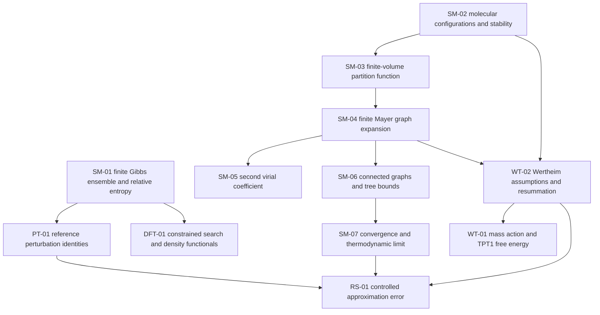

# Statistical associating fluid theory

## Abstract

Statistical associating fluid theory (SAFT) models the Helmholtz free energy of molecular fluids
through reference-fluid, chain, and association contributions. A scientific API map should connect
those formulas to the microscopic model, identify the assumptions used at each derivation step,
and state which consequences can be proved. The foundation below follows the route from
configurations and partition functions through interaction graphs and perturbation theory to a
specified SAFT approximation. It includes first formalization tasks, substantial results already
known in mathematical physics, and a proposed research objective concerning approximation error.

## Reading the map

**Existing upstream** means a named definition or result was located in the pinned Physlib or
Mathlib dependency. **Known result** means a cited mathematical or physical result whose relevant
Lean implementation still needs checking. **Formalization target** means a proposed theorem with
explicit hypotheses. **Model approximation** identifies a step that introduces a closure or
truncation. **Research objective** means a proposed result requiring a literature and feasibility
audit before any novelty or delivery claim.

The upstream references below were checked against the revisions in the current
[lake manifest](../lake-manifest.json). The map proposes theory statements and dependencies.
The [Execution](../Execution/) examples and [Input](../Input/) schema supply separate numerical
and input checks. Each later implementation should link its theorem back to the relevant item.

## Content (Alpha)

### Helmholtz free energy and the existing SAFT entry point

At fixed temperature, volume, and molecular amounts, the canonical ensemble {1} supplies a
Helmholtz free energy. [1] For a pure fluid, write the reduced free energy per molecule as
a = A/(N k_B T), with a = a^ideal + a^seg + a^chain + a^assoc for a specified SAFT recipe.
This decomposition defines the approximation being used. Its statistical-mechanical justification
depends on the reference model and the perturbation assumptions. {2} [TODO]

Record a fitted reference equation or contact function as an additional approximation, with its
coefficient source and applicability range. A theorem for the microscopic fluid and a derivative
theorem for an encoded fit then have an explicit approximation link to establish.

Pressure and chemical potentials follow from derivatives under their stated regularity and domain
conditions. Coexistence additionally requires equilibrium and stability conditions, with the
search domain specified. These derivative statements belong in
[ThermoDerivatives](../ThermoDerivatives/). Their microscopic prerequisites belong in
[PerturbationTheory](../PerturbationTheory/).

A molecule of component i has M_i association sites. Given molecular density rho, mole fractions
x_i, and finite bonding integrals Delta_ij^AB, the TPT1 model uses

$$
X_i^A = \frac{1}{1+\rho\sum_j x_j\sum_B X_j^B\Delta_{ij}^{AB}},
\qquad
a^{assoc}=\sum_i x_i\sum_A\left(\log X_i^A-X_i^A/2+1/2\right).
$$

These equations are a **model approximation** derived through Wertheim's framework. {2,3}
**Formalization target WT-01** starts with the symmetric two-site case. For K >= 0, prove a unique
physical solution X in (0,1] to X + K X^2 = 1, including K = 0, then derive the association energy
and its density derivative. For a general site network, state the active components, reciprocity,
positivity, and regularity hypotheses before proposing existence, uniqueness, or differentiability
theorems. [TODO] Solving the adopted mass-action equations and justifying them from a microscopic
fluid are separate proof obligations.

### Foundation and dependency map

The arrows trace the scientific route and planned connections. A microscopic bond model must be
fixed before a statement about its exact free energy or approximation error has a meaning.

### What is known and what must be justified

| Subject | What is established | Task for this map |
| --- | --- | --- |
| Ensembles and free energy | Physlib defines canonical ensembles, Boltzmann measures, and Helmholtz free energy, with associated thermodynamic results. [1] | Reuse the existing normalization and temperature conventions, then state the hypotheses needed by a molecular model. |
| Relative entropy | Mathlib has Gibbs' inequality and the zero-divergence criterion for finite measures. [2] | Connect the probability result to a finite Gibbs free-energy identity in SM-01. |
| Stable short-range fluids | Rigorous thermodynamic-limit results exist under suitable stability, decay, boundary, and state hypotheses. {4} | Select a precise theorem and ensemble for SM-07. A finite-volume definition alone leaves this limit to be proved. |
| Mayer and virial expansions | Known convergence bounds for stable, tempered pair potentials use graph identities and tree bounds. {5} | Formalize the finite graph algebra first, then the analytic bounds for a chosen interaction class. |
| Wertheim TPT1 | The published construction provides association and chain approximations with specified bonding and reference-correlation assumptions. {2,3} | Record each exact identity and each approximation in WT-02. A closed expression for TPT1 leaves its accuracy against the microscopic model to be established. |
| Classical density functionals | A constrained search over distributions with a specified density gives a variational formulation. Representability and universal bounds have rigorous treatments. {6,7} | Use these as later theory targets with their precise canonical or grand-canonical assumptions. |

### First formalization tasks

**SM-01. Finite Gibbs variational principle.** Start with a nonempty finite set of allowed
microstates, a finite real energy E on that set, and T > 0. Set beta = 1/(k_B T), Z = sum exp(-beta E),
and P_eq = exp(-beta E)/Z. Prove Z > 0 and normalization. For every probability distribution Q,
using the continuous extension of q log q at q = 0, prove

$$
\mathcal F_T[Q]-F_{eq}=k_B T\,D_{KL}(Q\Vert P_{eq})\geq0.
$$

This is a **known result** and a **formalization target**, using [1,2]. The first acceptance
criterion is an identity for every admissible Q and equality exactly at Q = P_eq. This supplies
a reusable foundation for reference-fluid bounds and the information interpretation of free
energy. Extension to continuous configurations requires absolute continuity, integrability, and
a fixed reference measure.

**SM-02. A small associating microscopic model.** Specify identical hard spheres with two
finite-range, finite-depth attractive sites and an explicitly normalized orientation measure.
Fix the patch geometry and whether it enforces single bonding at each site and excludes two
bonds between the same molecular pair. These are geometric claims to prove or explicit
restrictions in the chosen model. Allow association rings in the microscopic state space unless
the model explicitly excludes them. Record every such restriction.

First prove a finite-valence stability bound under the stated assumptions. If each of S sites can
belong to at most one bond, each bond energy is at least -epsilon_max, and the remaining energy
is nonnegative, then U_N >= -(S epsilon_max/2) N. This elementary bound is a **formalization
target**. Adding an attractive dispersion reference requires its own stability bound.

**SM-03. Finite-volume partition function.** Use the admissible configurations of SM-02.
Define the configurational integral with the N! factor, length normalization, and orientation
measure explicit. Handle hard-core exclusion with an admissibility indicator or an extended
energy. For finite volume, stability gives an integrable upper bound on the Boltzmann weight.
Prove positive measure of a nonempty set of allowed configurations with finite energy to obtain
Z_N > 0. Packing restrictions can make Z_N vanish, so specify the allowed N and container.
State how kinetic and rotational factors enter the physical partition function.

**SM-04. Finite Mayer identity.** For finitely many labeled particles in a pair-additive model,
define f_ij = exp(-beta u_ij) - 1, with f_ij = -1 on hard-core overlap. Prove the finite identity

$$
\prod_{i<j}(1+f_{ij})=\sum_{G\subseteq K_N}\prod_{\{i,j\}\in E(G)} f_{ij}.
$$

This is finite graph algebra and a **known result**. [3] supplies finite graph definitions.
First accept a theorem for arbitrary real edge weights, together with the empty-graph case and
one small exact example. No infinite-series convergence is needed for this identity. Any
additional model-wide admissibility constraint must be accounted for before identifying the
product with the full Boltzmann weight.

**SM-05. An exact dilute check.** For a translation-invariant rigid-molecule pair model with
normalized orientation measure nu and an integrable Mayer function, define the second virial
coefficient by

$$
B_2(T)=-\frac12\int_{\mathbb R^3\times\mathcal O^2}
\bigl(e^{-\beta u(r,\omega_1,\omega_2)}-1\bigr)
\,dr\,d\nu(\omega_1)\,d\nu(\omega_2).
$$

The connection to the density expansion of pressure requires the corresponding convergence and
inversion hypotheses. First check the hard-sphere limit and isolate a specified patch contribution.
Then compare this microscopic coefficient with the coefficient implied by the chosen TPT1
formula. Any mismatch should be traced to the stated reference or bonding approximation.
Integral certificates require a separate validated numerical method.

**PT-01. Reference-fluid perturbation.** After SM-01, take energies E_lambda = E_0 + lambda V on
the same finite microstate set. Prove F'(lambda) = expectation_lambda(V),
F''(lambda) = -beta Var_lambda(V), and F(1) <= F(0) + expectation_0(V).
These are **known results** with finite-sum proofs. For continuous fluids, add the required
differentiation and integrability hypotheses, and the support conditions for a variational bound.
A Barker-Henderson-style truncation subsequently needs bounds on the Taylor remainder and on any
approximate reference correlations. {9}

### Larger formalization targets

**SM-06. Connected graphs and tree bounds.** Start with an exact finite identity for a specified
partition scheme on connected graphs, following the Penrose construction. Its tree expression
retains correction factors. Prove the partition property before the weighted identity. Then map
one published tree bound to the chosen stability assumptions. {5} Passing to the logarithm of a
grand partition function requires a formal power-series argument or a domain of analytic
convergence. The finite Mayer identity alone does not justify that passage.

**SM-07. Convergence and the thermodynamic limit.** Separate the convergence of the low-activity
Mayer series from the general existence of a thermodynamic limit. State a stable, regular
interaction class, a consistent activity normalization, the admissible containers, and explicit
bounds. The hard-sphere-plus-patch model includes orientations, so verify the extension from any
theorem stated for position-only pair potentials. General Lennard-Jones stability is an additional
theorem before applying such results to a soft reference. {4,5}

The first analytic milestone is a published convergence bound with every constant and assumption
represented in Lean. The longer milestone is a precise thermodynamic-limit theorem and the
conditions needed for derivatives of that limit. Both are **known results** to select and
formalize. A low-activity convergence result has a restricted domain, while dense-liquid
coexistence requires additional arguments.

**WT-02. From bond graphs to the TPT1 closure.** Choose one exact microscopic model and trace
the published association derivation. Record separately the reference correlations, single-site
bonding, exclusion of multiple bonds for a pair where required, treatment of rings, and any
factorization of correlations between bonds. Establish the combinatorial or variational
identities that are exact under their stated assumptions, then explicitly identify the closure
leading to mass action and the displayed association free energy. {2,3}

A convergent Mayer expansion for the underlying pair model does not by itself justify the TPT1
resummation. Proving uniqueness of the resulting site fractions likewise addresses the adopted
equations. The relation of the closure to the microscopic Gibbs distribution remains a separate
theorem or approximation claim.

### Where the research difficulty lies

**RS-01. A controlled association approximation.** The proposed research question is whether
one can give a useful, explicit bound between the exact free energy per molecule of the SM-02
model and a completely specified TPT1 approximation on a stated temperature and density domain.
A desired statement has the form

$$
\left|a_{exact}(T,\rho)-a_{TPT1}(T,\rho)\right|\leq\varepsilon(T,\rho).
$$

Here both reduced free energies must use the same microscopic parameters and ideal-state
normalization. Define the thermodynamic limit or finite-volume normalization on both sides.
The function epsilon must have an explicit bound with a stated regime in which it is useful.

This is a **research objective**. Its novelty and feasibility need a targeted literature audit.
A first attempt should use a restricted model and a domain supported by a convergent expansion.
The proof would need quantitative control of omitted diagrams, association loops, steric
correlations between bonds, and any approximate reference functions. Published extensions that
include double bonding demonstrate why the selected diagram class matters. {8}

Useful intermediate outcomes include a rigorous bound at a fixed order in activity, an exact
low-order coefficient that the closure misses, or a counterexample to a proposed hypothesis.
A free-energy bound alone supplies no derivative error bound. Pressure and chemical-potential
guarantees need control of differentiated remainders. Extending a result to dense-liquid
coexistence additionally needs quantitative control of phase branches and their conditioning.

**DFT-01. Connection to spatial fluids.** After SM-01, first prove a finite ideal-gas wall example
in which the grand-potential gap is the relative entropy of density measures. Then map the
constrained-search definition of the exact interacting intrinsic functional and its
representability conditions. {6,7} An approximate SAFT-based functional needs separate
justification for its spatial closure and pair correlations. This branch gives a later
application of the same probability and free-energy foundation.

### Term-combination rules supported by the foundation

For each term, record its reference measure, molecular and segment density conventions, interaction
contributions already counted, required reference correlations, domain, and derivation assumptions.
A composite hard-chain reference can contain hard-sphere and chain contributions. Combining it
with another term requires checking those contributions for overlap and checking that the needed
contact correlations refer to the chosen model.

Treat a published recipe, a candidate with additional hypotheses, and a combination with a
demonstrated conflict as different outcomes of the scientific map. Keep this assembly question
distinct from the mixing rules that define unlike-species parameters. A candidate's mathematical
well-formedness, approximation justification, and agreement with simulation or experiment are
separate claims to record.

### Proposed implementation order and review

First formalize SM-01, SM-04, and WT-01 as small theorem statements with exact examples. Next
develop SM-02/03/05 and PT-01, then the analytic and resummation work in SM-06/07 and WT-02.
WT-01 can reuse the symmetric two-site proof from the external review implementation after its
definitions have been matched to this repository.
Use the external ethanol review certificate as evidence that numerical proposals can be checked
for an encoded equation of state. Its exact-real guarantees remain scoped to that encoded
approximation and its certified state windows.

Each implementation item should name its mathematical statement, source theorem or equation,
dependencies, domain, and acceptance test. Review the meaning of definitions and assumptions as
well as the proof. For an inference pilot, record attempted tasks, accepted results, failed
attempts, inference use, and expert review time. Count literature formalization and any newly
established research result separately.

## Lean References

1. [Physlib canonical ensemble map](https://github.com/leanprover-community/physlib/blob/4e2182f2b6f0a54207a2fa62002c264217f875d6/Physlib/StatisticalMechanics/CanonicalEnsemble/API-map.md),
   particularly CanonicalEnsemble.helmholtzFreeEnergy and the finite-ensemble results.
2. [Mathlib relative entropy](https://github.com/leanprover-community/mathlib4/blob/56a005855ea17e0b0958f73ec801ae140b0a1679/Mathlib/InformationTheory/KullbackLeibler/Basic.lean),
   including integral_llr_add_sub_measure_univ_nonneg and klDiv_eq_zero_iff.
3. [Mathlib finite graph definitions](https://github.com/leanprover-community/mathlib4/blob/56a005855ea17e0b0958f73ec801ae140b0a1679/Mathlib/Combinatorics/SimpleGraph/Basic.lean).
   These definitions supply graph objects. The weighted identities above remain proposed tasks.

## References

1. [Canonical ensemble API map](https://github.com/leanprover-community/physlib/blob/4e2182f2b6f0a54207a2fa62002c264217f875d6/Physlib/StatisticalMechanics/CanonicalEnsemble/API-map.md).
2. W. G. Chapman, K. E. Gubbins, G. Jackson and M. Radosz,
   [New reference equation of state for associating liquids](https://doi.org/10.1021/ie00104a021),
   Ind. Eng. Chem. Res. 29 (1990) 1709–1721.
   M. S. Wertheim, [Fluids with highly directional attractive forces. I. Statistical thermodynamics](https://doi.org/10.1007/BF01017362)
   and [II. Thermodynamic perturbation theory and integral equations](https://doi.org/10.1007/BF01017363),
   J. Stat. Phys. 35 (1984) 19–34 and 35–47.
3. S. Dufal et al.,
   [The A in SAFT](https://doi.org/10.1080/00268976.2015.1029027),
   Mol. Phys. 113 (2015) 948–984, with its
   [corrigendum](https://doi.org/10.1080/00268976.2017.1402604).
   The reference-fluid and association approximations in a
   specific implementation must be matched to their actual source equations.
4. D. Ruelle, Statistical Mechanics. Rigorous Results (1969), particularly the thermodynamic-limit
   construction. For an ensemble-specific analysis, see M. K.-H. Kiessling,
   [On Ruelle's construction of the thermodynamic limit for the classical microcanonical entropy](https://arxiv.org/abs/0810.2084).
5. A. Procacci and S. A. Yuhjtman,
   [Convergence of Mayer and Virial expansions and the Penrose tree-graph identity](https://arxiv.org/abs/1508.07379),
   Lett. Math. Phys. 107 (2017) 31–46. This is a source for exact graph identities and
   convergence bounds for a specified stable, tempered pair-potential class.
6. W. S. B. Dwandaru and M. Schmidt,
   [Variational principle of classical density functional theory via Levy's constrained search method](https://arxiv.org/abs/1104.3951),
   Phys. Rev. E 83 (2011) 061133.
7. M. Jex, M. Lewin and P. S. Madsen,
   [Classical Density Functional Theory. Representability and Universal Bounds](https://arxiv.org/abs/2210.07785),
   J. Stat. Phys. 190 (2023) 73.
8. M. P. Howard, Z. M. Sherman, D. J. Milliron and T. M. Truskett,
   [Wertheim's thermodynamic perturbation theory with double-bond association and its application to colloid-linker mixtures](https://arxiv.org/abs/2010.08027).
   J. Chem. Phys. 154 (2021) 024905.
   Verify the selected extension and diagram assumptions in the primary text before using it
   as a reference for a new approximation bound.
9. J. A. Barker and D. Henderson,
   [Perturbation Theory and Equation of State for Fluids. II. A Successful Theory of Liquids](https://doi.org/10.1063/1.1701689),
   J. Chem. Phys. 47 (1967) 4714–4721.

